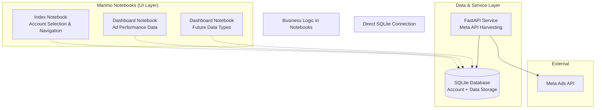

# Design Document

## Overview

This design transforms the existing FastAPI Meta Ads service into a comprehensive dashboard architecture using Marimo notebooks as the primary UI layer. The system will maintain the current FastAPI service for data extraction while adding SQLite database storage and a modular Marimo notebook structure for data visualization and analysis.

The architecture follows a three-tier approach:
1. **Data Layer**: SQLite database with dedicated schemas for different data job types
2. **Service Layer**: Enhanced FastAPI service for data extraction and API endpoints
3. **Presentation Layer**: Marimo notebooks for interactive dashboards and navigation

## Architecture

### Simplified Architecture Diagram



### Component Relationships

The architecture follows a simple relationship model:
**Admin User → Account ID → Data Job Type → Interactive Dashboards**

- **Index Notebook** connects directly to SQLite to list accounts and navigate to dashboards
- **Dashboard Notebooks** connect directly to SQLite with business logic embedded in the notebook
- **FastAPI Service** handles Meta API harvesting and stores data in SQLite (no complex middleware)
- **SQLite Database** stores account mappings, data job types, and extracted data (no logs)

## Components and Interfaces

### 1. Database Layer

#### SQLite Database Structure
```sql
-- Account management (mapped to API tokens)
CREATE TABLE accounts (
    account_id TEXT PRIMARY KEY,
    account_name TEXT NOT NULL,
    api_token_key TEXT NOT NULL,  -- Maps to which token can access this account
    last_updated TIMESTAMP DEFAULT CURRENT_TIMESTAMP
);

-- Data job types registry
CREATE TABLE data_job_types (
    job_type_id TEXT PRIMARY KEY,
    job_name TEXT NOT NULL,
    description TEXT,
    table_name TEXT NOT NULL,  -- Which table stores this job type's data
    is_active BOOLEAN DEFAULT TRUE
);

-- Current data job type: ad performance insights
CREATE TABLE ad_performance_data (
    id INTEGER PRIMARY KEY AUTOINCREMENT,
    account_id TEXT NOT NULL,
    date_start DATE NOT NULL,
    date_stop DATE NOT NULL,
    campaign_id TEXT,
    campaign_name TEXT,
    adset_id TEXT,
    adset_name TEXT,
    ad_id TEXT,
    ad_name TEXT,
    impressions INTEGER,
    clicks INTEGER,
    spend DECIMAL(10,2),
    reach INTEGER,
    frequency DECIMAL(5,2),
    cpm DECIMAL(10,2),
    cpc DECIMAL(10,2),
    ctr DECIMAL(5,2),
    extracted_at TIMESTAMP DEFAULT CURRENT_TIMESTAMP,
    FOREIGN KEY (account_id) REFERENCES accounts(account_id)
);
```

#### Database Utilities Interface
```python
class DatabaseManager:
    def __init__(self, db_path: str = "data/meta_ads.db")
    async def get_connection(self) -> sqlite3.Connection
    async def create_schema(self, schema_name: str, schema_definition: dict)
    async def get_accounts(self) -> List[Dict[str, Any]]
    async def get_data_job_types(self) -> List[str]
    async def query_data(self, schema: str, account_id: str, filters: dict) -> List[Dict[str, Any]]
```

### 2. Enhanced FastAPI Service

#### Modified Endpoints
```python
# Existing endpoints (maintained)
GET /api/v1/accounts
GET /health
GET /api/v1/metrics

# New database-focused endpoints
GET /api/v1/data-job-types
GET /api/v1/data/{job_type}/{account_id}
POST /api/v1/extract/{job_type}/{account_id}
```

#### Data Extraction Service Enhancement
```python
class DataExtractionService:
    def __init__(self, meta_client: MetaAPIClient, db_manager: DatabaseManager)
    
    async def extract_and_store(
        self, 
        account_id: str, 
        job_type: str, 
        date_range: dict
    ) -> Dict[str, Any]
    
    async def get_stored_data(
        self, 
        account_id: str, 
        job_type: str, 
        filters: dict = None
    ) -> List[Dict[str, Any]]
```

### 3. Marimo Notebook Structure

#### Index Notebook (`notebooks/index.py`)
```python
import marimo as mo
import sqlite3
from typing import List, Dict

# Account selection interface
account_selector = mo.ui.dropdown(
    options=get_available_accounts(),
    label="Select Account"
)

# Data job type selection
job_type_selector = mo.ui.dropdown(
    options=get_available_job_types(),
    label="Select Data Type"
)

# Navigation buttons
dashboard_links = mo.md(f"""
## Available Dashboards for {account_selector.value}
- [Ad Performance Dashboard](./ad_performance.py?account_id={account_selector.value})
- [Campaign Analytics Dashboard](./campaign_analytics.py?account_id={account_selector.value})
""")
```

#### Dashboard Notebook Template (`notebooks/dashboard_template.py`)
```python
import marimo as mo
import pandas as pd
import plotly.express as px
from database_utils import DatabaseManager

# Get account_id from URL parameters
account_id = mo.ui.text(label="Account ID", value=get_url_param("account_id"))

# Data loading and filtering
db_manager = DatabaseManager()
data = db_manager.query_data(
    schema="ad_performance", 
    account_id=account_id.value,
    filters={}
)

# Interactive visualizations
df = pd.DataFrame(data)
chart = px.line(df, x="date_start", y="spend", title="Daily Spend Trend")

# Display components
mo.md("# Ad Performance Dashboard")
account_id
chart
```

### 4. Configuration Management

#### Enhanced Settings
```python
class Settings:
    # Existing Meta API settings
    meta_api_version: str
    meta_access_tokens: str
    
    # New database settings
    sqlite_db_path: str = "data/meta_ads.db"
    enable_auto_schema_creation: bool = True
    
    # Marimo notebook settings
    notebooks_path: str = "notebooks"
    default_dashboard_port: int = 2718
```

## Data Models

### Database Schema Models
```python
from sqlalchemy import Column, Integer, String, DateTime, Decimal, ForeignKey
from sqlalchemy.ext.declarative import declarative_base

Base = declarative_base()

class Account(Base):
    __tablename__ = 'accounts'
    account_id = Column(String, primary_key=True)
    account_name = Column(String, nullable=False)
    last_updated = Column(DateTime, default=datetime.utcnow)

class AdPerformance(Base):
    __tablename__ = 'ad_performance'
    id = Column(Integer, primary_key=True, autoincrement=True)
    account_id = Column(String, ForeignKey('accounts.account_id'), nullable=False)
    date_start = Column(DateTime, nullable=False)
    date_stop = Column(DateTime, nullable=False)
    # ... additional performance metrics
```

### API Response Models
```python
class DataJobType(BaseModel):
    name: str
    description: str
    schema_name: str
    available_fields: List[str]

class DataExtractionResponse(BaseModel):
    job_type: str
    account_id: str
    records_extracted: int
    date_range: Dict[str, str]
    extraction_time: datetime
```

## Error Handling

### Database Error Handling
```python
class DatabaseException(Exception):
    def __init__(self, message: str, operation: str = None):
        self.message = message
        self.operation = operation
        super().__init__(self.message)

class SchemaNotFoundException(DatabaseException):
    pass

class ConnectionException(DatabaseException):
    pass
```

### Notebook Error Handling
- Graceful degradation when database is unavailable
- Clear error messages for missing data
- Fallback to cached data when possible
- User-friendly error displays in Marimo interface

## Testing Strategy

### Unit Testing
- Database utility functions
- Data extraction service methods
- API endpoint responses
- Schema creation and validation

### Integration Testing
- End-to-end data flow from Meta API to database
- Notebook database connectivity
- FastAPI service with SQLite backend

### Notebook Testing
- Marimo notebook functionality validation
- Interactive component behavior
- Data visualization accuracy
- Navigation between notebooks

### Performance Testing
- Database query performance with large datasets
- Concurrent notebook access
- Memory usage with multiple dashboard instances

## Implementation Phases

### Phase 1: Database Foundation
1. SQLite database setup and schema creation
2. Database utility classes and connection management
3. Migration from CSV to database storage in FastAPI service

### Phase 2: Enhanced FastAPI Service
1. New database-focused API endpoints
2. Modified data extraction to store in SQLite
3. Account and data job type management endpoints

### Phase 3: Marimo Integration
1. Index notebook for account selection and navigation
2. First dashboard notebook (ad performance)
3. Database connection utilities for notebooks

### Phase 4: Modular Dashboard System
1. Dashboard notebook template system
2. Dynamic schema discovery and notebook generation
3. Enhanced navigation and filtering capabilities

### Phase 5: Documentation and Setup
1. Updated README with new architecture
2. Setup scripts for database initialization
3. Development and deployment documentation