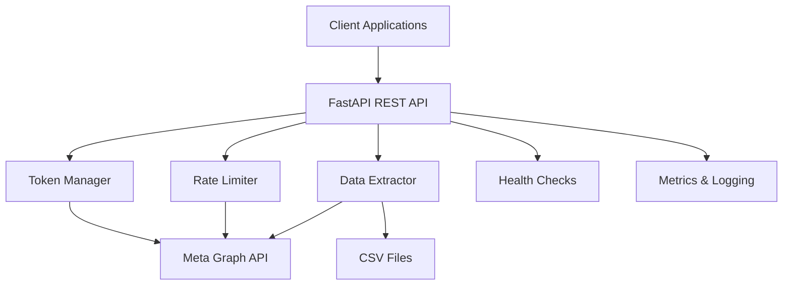

# Design Document

## Overview

The Meta Ads API Service is a FastAPI-based application designed to extract advertising data from Meta's Graph API v23.0 with intelligent rate limiting, token management, and background job processing. The service addresses Meta's platform limitations by providing comprehensive data extraction capabilities for analysis in external BI tools.

## Architecture

### High-Level Architecture



### Service Components

1. **FastAPI Application Layer**: REST API endpoints and request handling
2. **Token Management Layer**: Multi-token rotation and cooldown management
3. **Rate Limiting Layer**: Exponential backoff and error handling
4. **Data Extraction Layer**: Meta API client and data processing
5. **CSV Export Layer**: Structured data output to files

## Components and Interfaces

### 1. FastAPI Application (`app/main.py`)

**Purpose**: Main application entry point with route definitions

**Key Features**:
- CORS middleware configuration
- Exception handling middleware
- Health check endpoints
- API versioning with `/api/v1` prefix

**Routes**:
```python
POST /api/v1/extract/start          # Start extraction job
GET  /api/v1/extract/{job_id}       # Get job status
GET  /api/v1/extract/{job_id}/logs  # Get job logs
GET  /api/v1/accounts               # List available ad accounts
GET  /health                        # Health check
GET  /metrics                       # Prometheus metrics
```

### 2. Token Manager (`app/core/token_manager.py`)

**Purpose**: Manages multiple Meta access tokens with intelligent rotation

**Interface**:
```python
class TokenManager:
    async def get_available_token(self) -> str
    async def report_rate_limit(self, token: str, cooldown_seconds: int)
    async def get_token_stats(self) -> Dict[str, Any]
    def is_token_available(self, token: str) -> bool
```

**Features**:
- Round-robin token distribution
- Cooldown tracking with timestamps
- Thread-safe operations using asyncio locks
- Token health monitoring

### 3. Rate Limiter (`app/core/rate_limiter.py`)

**Purpose**: Handles Meta API rate limiting with sophisticated backoff strategies

**Interface**:
```python
class RateLimiter:
    async def execute_with_backoff(self, func: Callable, *args, **kwargs) -> Any
    def calculate_backoff(self, attempt: int, error_code: int) -> float
    async def handle_rate_limit_error(self, error: dict, token: str)
```

**Backoff Strategy**:
- Base delay: 2 seconds
- Exponential multiplier: 2^attempt
- Maximum delay: 300 seconds
- Jitter: 0-5 seconds random
- Error-specific cooldowns

### 4. Meta API Client (`app/services/meta_client.py`)

**Purpose**: Async HTTP client for Meta Graph API interactions

**Interface**:
```python
class MetaAPIClient:
    async def get_ad_accounts(self) -> List[Dict]
    async def get_insights(self, account_id: str, params: InsightsParams) -> AsyncIterator[Dict]
    async def get_campaigns(self, account_id: str) -> List[Dict]
    async def paginate_results(self, url: str, params: dict) -> AsyncIterator[Dict]
```

**Features**:
- HTTP/2 support with httpx
- Connection pooling (max 100 connections)
- Automatic retry with circuit breaker
- Request/response logging
- Cursor-based pagination

### 5. Job Processor (`app/services/job_processor.py`)

**Purpose**: Background task management for long-running extractions

**Interface**:
```python
class JobProcessor:
    async def create_job(self, job_request: JobRequest) -> str
    async def get_job_status(self, job_id: str) -> JobStatus
    async def process_extraction_job(self, job_id: str, params: ExtractionParams)
```

**Job States**:
- `pending`: Job created, waiting to start
- `running`: Job in progress
- `completed`: Job finished successfully
- `failed`: Job failed with errors
- `cancelled`: Job cancelled by user

### 6. Data Extractor (`app/services/data_extractor.py`)

**Purpose**: Orchestrates data extraction with chunking and parallel processing

**Interface**:
```python
class DataExtractor:
    async def extract_insights_data(self, params: ExtractionParams) -> AsyncIterator[Dict]
    def create_date_chunks(self, start_date: str, end_date: str) -> List[Tuple[str, str]]
    async def process_chunk(self, chunk: DateChunk, params: ExtractionParams) -> List[Dict]
```

**Chunking Strategy**:
- Default chunk size: 7 days
- Monthly chunks for large ranges
- Parallel processing with semaphore (max 5 concurrent)
- Automatic retry for failed chunks

## Data Models

### 1. Request Models (`app/models/requests.py`)

```python
class ExtractionRequest(BaseModel):
    account_ids: List[str]
    start_date: str  # YYYY-MM-DD format
    end_date: str
    fields: Optional[List[str]] = None
    breakdowns: Optional[List[str]] = None
    chunk_size_days: Optional[int] = 7

class JobRequest(BaseModel):
    extraction_params: ExtractionRequest
    job_name: Optional[str] = None
    priority: Optional[int] = 1
```

### 2. Response Models (`app/models/responses.py`)

```python
class JobResponse(BaseModel):
    job_id: str
    status: JobStatus
    created_at: datetime
    progress: Optional[JobProgress] = None

class JobProgress(BaseModel):
    total_chunks: int
    completed_chunks: int
    processed_records: int
    estimated_completion: Optional[datetime]
```

### 3. CSV Output Models (`app/models/csv_output.py`)

```python
# Jobs table
class Job(BaseModel):
    id: str
    status: JobStatus
    params: dict
    created_at: datetime
    updated_at: datetime
    error_message: Optional[str]

# Insights data table
class InsightsData(BaseModel):
    id: str
    job_id: str
    account_id: str
    campaign_id: str
    adset_id: str
    ad_id: str
    date_start: date
    impressions: int
    spend: Decimal
    clicks: int
    # ... additional metrics
```

## Error Handling

### 1. Meta API Error Mapping

```python
META_ERROR_CODES = {
    4: {"cooldown": 25, "description": "Application request limit"},
    17: {"cooldown": 15, "description": "User request limit"},
    32: {"cooldown": 20, "description": "Page request limit"},
    613: {"cooldown": 12, "description": "Rate limit exceeded"}
}
```

### 2. Exception Hierarchy

```python
class MetaAPIException(Exception): pass
class RateLimitException(MetaAPIException): pass
class TokenException(MetaAPIException): pass
class DataExtractionException(MetaAPIException): pass
```

### 3. Error Response Format

```python
class ErrorResponse(BaseModel):
    error_code: str
    message: str
    details: Optional[dict]
    correlation_id: str
    timestamp: datetime
```

## Testing Strategy

### 1. Unit Tests
- Token manager rotation logic
- Rate limiter backoff calculations
- Data transformation functions
- Request/response model validation

### 2. Integration Tests
- Meta API client with mock responses
- CSV output validation and format testing
- End-to-end job processing workflows

### 3. Load Tests
- Concurrent token usage
- Rate limiting under high load
- CSV file generation performance
- Memory usage during large extractions

## Configuration Management

### Environment Variables

```python
class Settings(BaseSettings):
    # Meta API Configuration
    meta_api_version: str = "v23.0"
    meta_access_tokens: List[str]  # Comma-separated tokens
    
    # Rate Limiting
    max_concurrent_requests: int = 5
    base_backoff_seconds: int = 2
    max_backoff_seconds: int = 300
    
    # CSV Output
    csv_output_directory: str = "./output"
    
    # Job Processing
    max_job_workers: int = 3
    job_timeout_minutes: int = 60
    
    # Logging
    log_level: str = "INFO"
    log_format: str = "json"
    
    class Config:
        env_file = ".env"
```

## Security Considerations

### 1. Token Security
- Tokens loaded from environment variables only
- No token logging or exposure in responses
- Secure token rotation and storage

### 2. Input Validation
- Pydantic models for all request validation
- SQL injection prevention with parameterized queries
- Rate limiting on API endpoints

### 3. Data Protection
- HTTPS enforcement for external communications
- Secure file system access for CSV output
- Audit logging for data access

## Performance Optimizations

### 1. HTTP Client Optimization
- Connection pooling with keep-alive
- HTTP/2 support for multiplexing
- Compression support (gzip)
- Timeout configuration (30s connect, 300s read)

### 2. Database Optimization
- Async connection pooling
- Batch insert operations
- Proper indexing on query columns
- Connection health checks

### 3. Memory Management
- Streaming data processing
- Chunked CSV writing operations
- Garbage collection optimization
- Memory usage monitoring

## Monitoring and Observability

### 1. Metrics Collection
- API request/response times
- Token usage statistics
- Job completion rates
- CSV file generation performance
- Error rates by type

### 2. Logging Strategy
- Structured JSON logging
- Correlation IDs for request tracing
- Log levels: DEBUG, INFO, WARNING, ERROR
- Log rotation and retention

### 3. Health Checks
- File system accessibility
- Meta API accessibility
- Token validity
- System resource usage