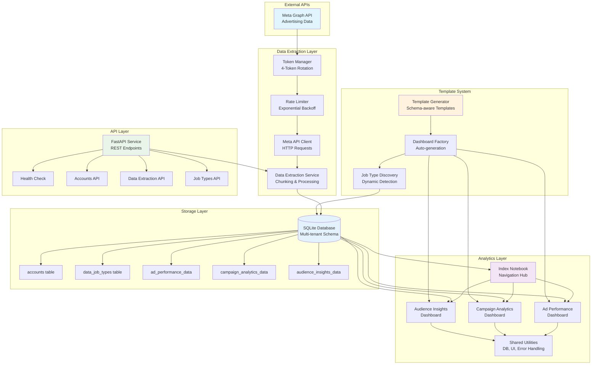

# 🏗️ System Architecture

Comprehensive architecture documentation for the Meta Ads Analytics Dashboard system.

## 🎯 Overview

The system combines **FastAPI** for data extraction, **SQLite** for storage, and **Marimo** for interactive analytics in a modular, template-driven architecture.

## 📊 Architecture Diagram



## 🔄 Data Flow

### 1. Data Extraction Flow
```
Meta Graph API → Token Manager → Rate Limiter → Meta API Client → Data Extraction Service → SQLite Database
```

### 2. Dashboard Generation Flow
```
Database Schema → Job Type Discovery → Template Generator → Dashboard Factory → Marimo Notebooks
```

### 3. Analytics Flow
```
User Request → Index Notebook → Account Selection → Dashboard Navigation → Data Visualization
```

## 🏛️ Component Architecture

### Data Extraction Layer

**FastAPI Service** (`app/`)
- **Purpose**: RESTful API for data extraction and management
- **Technology**: FastAPI with async/await patterns
- **Features**: Auto-generated OpenAPI docs, request validation
- **Endpoints**: `/extract`, `/accounts`, `/job-types`, `/health`

**Meta API Client** (`app/services/`)
- **Purpose**: Interface with Meta Graph API
- **Features**: Token rotation, rate limiting, error handling
- **Data Sources**: Ad insights, campaign data, account information
- **Processing**: Chunking, deduplication, data transformation

### Storage Layer

**SQLite Database** (`data/meta_ads.db`)
- **Purpose**: Multi-tenant data storage
- **Schema**: Account-based partitioning with job type registry
- **Features**: WAL mode for concurrency, indexed queries
- **Tables**: Core (accounts, job_types) + Data tables per job type

**Database Schema:**
```sql
-- Core tables
accounts (account_id PK, account_name, api_token_key, last_updated)
data_job_types (job_type_id PK, job_name, description, table_name, is_active)

-- Data tables (one per job type)
ad_performance_data (id PK, account_id FK, date_start, campaign_name, impressions, clicks, spend, ...)
campaign_analytics_data (id PK, account_id FK, date_start, campaign_name, conversions, roas, ...)
audience_insights_data (id PK, account_id FK, date_start, age_range, gender, location, ...)
```

### Template System

**Template Generator** (`notebooks/utils/template_generator.py`)
- **Purpose**: Creates dashboard templates from database schema
- **Features**: Schema introspection, metric configuration, chart type selection
- **Output**: Complete Marimo notebook files with error handling

**Dashboard Factory** (`notebooks/utils/dashboard_factory.py`)
- **Purpose**: Manages dashboard lifecycle and discovery
- **Features**: Auto-generation, registry management, statistics tracking
- **Integration**: Database schema monitoring, template application

### Analytics Layer

**Marimo Notebooks** (`notebooks/`)
- **Technology**: Reactive Python notebooks with web interface
- **Features**: Interactive widgets, real-time updates, modular cells
- **Components**: Index navigation, specialized dashboards, shared utilities

**Index Notebook** (`notebooks/index.py`)
- **Purpose**: Central navigation and account management
- **Features**: Account selection, dashboard discovery, system status
- **UI**: Dropdown filters, dashboard cards, status indicators

**Dashboard Notebooks** (`notebooks/*_dashboard.py`)
- **Purpose**: Specialized analytics for each job type
- **Features**: KPI cards, interactive charts, data tables, filtering
- **Patterns**: Account filtering, error handling, responsive layout

## 🔧 Technical Specifications

### Database Design

**Multi-tenancy Pattern:**
```sql
-- All data queries include account_id filter
SELECT * FROM ad_performance_data WHERE account_id = :account_id AND date_start >= :start_date
```

**Job Type Registry:**
```sql
-- Dynamic job type discovery
SELECT job_type_id, table_name FROM data_job_types WHERE is_active = 1
```

**Indexing Strategy:**
```sql
-- Performance optimization
CREATE INDEX idx_ad_performance_account_date ON ad_performance_data(account_id, date_start);
CREATE INDEX idx_campaign_analytics_account ON campaign_analytics_data(account_id);
```

### Template System Design

**Schema Introspection:**
```python
def get_table_schema(self, table_name: str) -> List[Dict[str, str]]:
    cursor = conn.execute(f"PRAGMA table_info({table_name})")
    return [{'name': row['name'], 'type': row['type']} for row in cursor.fetchall()]
```

**Dynamic Configuration:**
```python
dashboard_config = {
    'ad_performance': {
        'primary_metrics': ['impressions', 'clicks', 'spend'],
        'chart_types': ['time_series', 'bar_chart', 'scatter_plot'],
        'default_filters': {'date_range': 30}
    }
}
```

### Marimo Integration

**Reactive Cell Pattern:**
```python
@app.cell
def __(dependency1, dependency2):
    # Cell automatically re-executes when dependencies change
    result = process_data(dependency1, dependency2)
    return result,
```

**UI Component Integration:**
```python
@app.cell
def __(mo):
    filter_ui = mo.ui.dropdown(options={"30": "30 days"})
    return filter_ui,

@app.cell
def __(filter_ui, db_manager):
    # Reactive data loading based on UI state
    data = db_manager.get_data(days=int(filter_ui.value))
    return data,
```

## 🔒 Security Architecture

### Multi-tenant Security

**Account Isolation:**
- All database queries filter by `account_id`
- API endpoints validate account access
- Dashboard navigation respects account boundaries

**Data Access Control:**
```python
# All data access patterns include account filtering
def get_data(self, account_id: str, job_type: str):
    query = f"SELECT * FROM {table_name} WHERE account_id = :account_id"
    return self.query_to_dataframe(query, {"account_id": account_id})
```

### API Security

**Token Management:**
- Environment variable storage for API tokens
- Token rotation for rate limit distribution
- No token exposure in logs or responses

**Input Validation:**
```python
class ExtractionRequest(BaseModel):
    account_ids: List[str] = Field(..., min_items=1, max_items=10)
    start_date: date = Field(..., description="Start date for data extraction")
    end_date: date = Field(..., description="End date for data extraction")
```

## 📈 Scalability Considerations

### Database Scaling

**Current Limits:**
- SQLite: ~1TB database size, thousands of concurrent readers
- Single-writer limitation (FastAPI service)
- File-based storage for simple deployment

**Scaling Options:**
- PostgreSQL migration for multi-writer scenarios
- Read replicas for dashboard scaling
- Partitioning by date ranges for large datasets

### Dashboard Scaling

**Current Architecture:**
- One Marimo process per dashboard instance
- Shared database connections with connection pooling
- Template-based generation for consistency

**Scaling Strategies:**
- Dashboard caching for frequently accessed data
- Lazy loading for large datasets
- Pagination for data tables

### API Scaling

**Rate Limiting:**
- Meta API: 200 calls per hour per token (4 tokens = 800/hour)
- Exponential backoff for rate limit handling
- Request queuing and batching

**Horizontal Scaling:**
- Stateless FastAPI service design
- Database connection pooling
- Load balancer compatibility

## 🔄 Extension Points

### Adding New Data Sources

1. **Create Job Type:**
   ```sql
   INSERT INTO data_job_types VALUES ('new_source', 'New Source', 'Description', 'new_source_data', 1);
   ```

2. **Create Data Table:**
   ```sql
   CREATE TABLE new_source_data (id INTEGER PRIMARY KEY, account_id TEXT, ...);
   ```

3. **Auto-generate Dashboard:**
   ```bash
   uv run python scripts/generate_dashboards.py
   ```

### Custom Visualizations

**Template Customization:**
```python
# Edit notebooks/utils/template_generator.py
def _get_dashboard_config(self, job_type_id: str):
    configs = {
        'custom_type': {
            'primary_metrics': ['custom_metric'],
            'chart_types': ['custom_chart'],
            'default_filters': {'custom_filter': 'value'}
        }
    }
```

**Manual Dashboard Creation:**
```python
# Create notebooks/custom_dashboard.py
# Follow existing patterns for consistency
# Use shared utilities from notebooks/utils/
```

### API Extensions

**New Endpoints:**
```python
# app/main.py
@app.get("/api/v1/custom")
async def custom_endpoint():
    return {"data": "custom_response"}
```

**New Data Sources:**
```python
# app/services/custom_client.py
class CustomAPIClient:
    def extract_data(self, account_id: str) -> List[Dict]:
        # Custom data extraction logic
        pass
```

## 🎯 Design Principles

### Modularity
- **Template-driven**: Consistent patterns across dashboards
- **Component-based**: Reusable utilities and UI components
- **Plugin architecture**: Easy addition of new job types

### Maintainability
- **Auto-generation**: Reduces manual coding for new dashboards
- **Shared utilities**: Common functionality in reusable modules
- **Clear separation**: Data, template, and presentation layers

### User Experience
- **Reactive interface**: Real-time updates with Marimo
- **Intuitive navigation**: Account-based dashboard discovery
- **Error handling**: Graceful degradation and user feedback

### Performance
- **Efficient queries**: Indexed database access patterns
- **Lazy loading**: On-demand data retrieval
- **Caching**: Template and data caching where appropriate