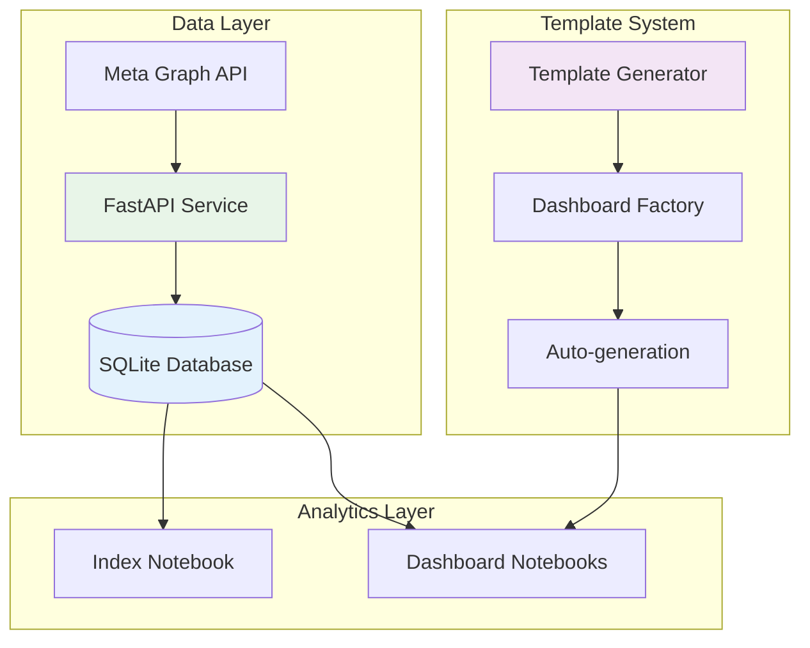

# 🛠️ Development Guide

Complete guide for developing and extending the Meta Ads Analytics Dashboard system.

## 🏗️ Architecture Overview



## 🚀 Quick Development Setup

```bash
# Complete system setup
uv run python scripts/setup_system.py

# Start development servers
uv run uvicorn app.main:app --reload --port 8000 &
uv run marimo edit notebooks/index.py --port 2718
```

## 📊 Adding New Dashboard Types

### 1. Database Schema Setup

```sql
-- Add new job type
INSERT INTO data_job_types (
    job_type_id, 
    job_name, 
    description, 
    table_name, 
    is_active
) VALUES (
    'conversion_funnel',
    'Conversion Funnel Analysis', 
    'Step-by-step conversion tracking and optimization',
    'conversion_funnel_data',
    1
);

-- Create corresponding data table
CREATE TABLE conversion_funnel_data (
    id INTEGER PRIMARY KEY AUTOINCREMENT,
    account_id TEXT NOT NULL,
    date_start DATE NOT NULL,
    date_stop DATE NOT NULL,
    funnel_step TEXT,
    step_order INTEGER,
    users_entered INTEGER,
    users_completed INTEGER,
    conversion_rate DECIMAL(5,2),
    extracted_at TIMESTAMP DEFAULT CURRENT_TIMESTAMP,
    FOREIGN KEY (account_id) REFERENCES accounts(account_id)
);
```

### 2. Auto-Generate Dashboard

```bash
# Generate dashboard notebook automatically
uv run python scripts/generate_dashboards.py

# This creates: notebooks/conversion_funnel_dashboard.py
```

### 3. Customize Dashboard (Optional)

```python
# Edit the generated dashboard for specific visualizations
# File: notebooks/conversion_funnel_dashboard.py

# Add custom funnel visualization
@app.cell
def __(filtered_data, px):
    # Custom funnel chart
    funnel_data = filtered_data.groupby(['funnel_step', 'step_order']).agg({
        'users_entered': 'sum',
        'users_completed': 'sum'
    }).reset_index().sort_values('step_order')
    
    funnel_chart = px.funnel(
        funnel_data,
        x='users_entered',
        y='funnel_step',
        title='Conversion Funnel Analysis'
    )
    
    return funnel_chart,
```

### 4. Test and Deploy

```bash
# Test the new dashboard
uv run marimo run notebooks/conversion_funnel_dashboard.py --headless

# Verify in index
uv run marimo run notebooks/index.py --port 2718
```

## 🔧 Core Components

### FastAPI Service (`app/`)

**Key Files:**
- `main.py` - FastAPI application and routes
- `core/database.py` - Database connection and utilities
- `services/data_extraction_service.py` - Meta API integration
- `models/` - Pydantic models for requests/responses

**Adding New API Endpoints:**
```python
# app/main.py
@app.get("/api/v1/custom-endpoint")
async def custom_endpoint():
    # Your custom logic
    return {"status": "success"}
```

### Database Layer (`data/meta_ads.db`)

**Core Tables:**
- `accounts` - Multi-tenant account management
- `data_job_types` - Dashboard type registry
- `*_data` - Data tables for each job type

**Schema Conventions:**
- All data tables must have `account_id` for multi-tenancy
- Include `date_start`, `date_stop` for time filtering
- Add `extracted_at` timestamp for data lineage

### Template System (`notebooks/utils/`)

**Key Components:**
- `template_generator.py` - Creates dashboard templates
- `dashboard_factory.py` - Manages dashboard lifecycle
- `db_connection.py` - Database utilities for notebooks
- `common.py` - Shared UI components
- `error_handler.py` - Consistent error handling

**Template Customization:**
```python
# notebooks/utils/template_generator.py
def _get_dashboard_config(self, job_type_id: str) -> Dict[str, Any]:
    configs = {
        'your_job_type': {
            'primary_metrics': ['custom_metric1', 'custom_metric2'],
            'chart_types': ['custom_chart', 'time_series'],
            'default_filters': {'date_range': 60}
        }
    }
    return configs.get(job_type_id, default_config)
```

## 📊 Dashboard Development

### Marimo Notebook Patterns

**Cell Structure:**
```python
@app.cell
def __():
    # Imports
    import marimo as mo
    import pandas as pd
    return mo, pd

@app.cell  
def __(mo):
    # UI Components
    filter_ui = mo.ui.dropdown(options={"30": "30 days"})
    return filter_ui,

@app.cell
def __(filter_ui, db_manager):
    # Data Loading
    data = db_manager.get_data(days=int(filter_ui.value))
    return data,

@app.cell
def __(mo, data):
    # Visualization
    chart = create_chart(data)
    mo.md("## Results")
    chart
    return
```

**Best Practices:**
- Always filter by `account_id` for security
- Use error handlers for graceful degradation
- Include data quality validation
- Follow consistent UI patterns
- Handle empty data states

### UI Component Library

**Available Components:**
```python
# Dropdowns and filters
date_filter = mo.ui.dropdown(options={"7": "7 days", "30": "30 days"})

# Data tables
table = mo.ui.table(data, selection="multi", page_size=20)

# Charts (using Plotly)
chart = px.line(data, x='date', y='metric', title='Trend Analysis')

# KPI cards
kpi = mo.stat(label="Total Spend", value="$1,234", caption="This month")

# Layout
dashboard = mo.vstack([header, filters, charts, table])
```

## 🧪 Testing and Validation

### Unit Testing

```bash
# Test database utilities
python -m pytest tests/test_db_connection.py

# Test template generation
python -m pytest tests/test_template_generator.py

# Test dashboard factory
python -m pytest tests/test_dashboard_factory.py
```

### Integration Testing

```bash
# Test complete data flow
uv run python run_test.py

# Test dashboard generation
uv run python scripts/generate_dashboards.py

# Validate notebook syntax
uv run marimo check notebooks/*.py
```

### Manual Testing

```bash
# Test individual dashboard
uv run marimo run notebooks/ad_performance_dashboard.py?account_id=test_account

# Test with sample data
sqlite3 data/meta_ads.db "INSERT INTO accounts VALUES ('test', 'Test Account', 'token', datetime('now'))"
```

## 🔍 Debugging and Troubleshooting

### Common Issues

| Issue | Cause | Solution |
|-------|-------|----------|
| Dashboard not appearing | Job type not in database | Check `data_job_types` table |
| No data in dashboard | Missing account data | Run data extraction first |
| Template generation fails | Invalid table schema | Check table exists and has required columns |
| Notebook syntax errors | Marimo cell dependencies | Use `marimo check` to validate |

### Debug Commands

```bash
# Check database schema
sqlite3 data/meta_ads.db ".schema"

# List available dashboards
python -c "from notebooks.utils.dashboard_factory import dashboard_factory; print(dashboard_factory.get_dashboard_registry())"

# Test database connection
python -c "from notebooks.utils.db_connection import db_manager; print(db_manager.test_connection())"

# Validate all notebooks
find notebooks -name "*.py" -exec uv run marimo check {} \;
```

### Logging and Monitoring

```python
# Enable debug logging
import logging
logging.basicConfig(level=logging.DEBUG)

# Database query logging
# Set in notebooks/utils/db_connection.py
logger.setLevel(logging.DEBUG)
```

## 📈 Performance Optimization

### Database Optimization

```sql
-- Add indexes for common queries
CREATE INDEX idx_ad_performance_account_date ON ad_performance_data(account_id, date_start);
CREATE INDEX idx_campaign_analytics_account ON campaign_analytics_data(account_id);

-- Enable WAL mode for better concurrency
PRAGMA journal_mode=WAL;
PRAGMA busy_timeout=5000;
```

### Dashboard Performance

- **Limit data ranges**: Default to 30 days, allow user selection
- **Pagination**: Use `mo.ui.table` with `page_size` parameter
- **Lazy loading**: Load charts only when tabs are selected
- **Caching**: Cache expensive calculations in notebook cells

## 🚀 Deployment Considerations

### Production Setup

```bash
# Use production WSGI server
uv run gunicorn app.main:app -w 4 -k uvicorn.workers.UvicornWorker

# Run dashboards as apps (read-only)
uv run marimo run notebooks/index.py --port 2718 --host 0.0.0.0
```

### Security

- **Environment Variables**: Never commit API tokens
- **Account Isolation**: Always filter by `account_id`
- **Input Validation**: Validate all user inputs
- **Database Security**: Use parameterized queries

### Monitoring

```python
# Health check endpoint
@app.get("/health")
async def health_check():
    return {
        "status": "healthy",
        "database": db_manager.test_connection(),
        "dashboards": len(dashboard_factory.get_dashboard_registry())
    }
```

## 📚 Additional Resources

- **[Marimo Documentation](https://docs.marimo.io/)** - Reactive notebook framework
- **[FastAPI Documentation](https://fastapi.tiangolo.com/)** - Modern Python web framework
- **[SQLite Documentation](https://sqlite.org/docs.html)** - Lightweight database
- **[Plotly Documentation](https://plotly.com/python/)** - Interactive visualizations
- **[Meta Graph API](https://developers.facebook.com/docs/graph-api/)** - Meta advertising API

## 🤝 Contributing

1. **Fork** the repository
2. **Create** a feature branch: `git checkout -b feature/new-dashboard`
3. **Develop** following the patterns in this guide
4. **Test** with `uv run python scripts/generate_dashboards.py`
5. **Submit** a pull request with clear description

### Code Style

- **Python**: Follow PEP 8, use type hints
- **SQL**: Use uppercase keywords, consistent naming
- **Marimo**: Follow reactive patterns, avoid side effects
- **Documentation**: Update README and docstrings