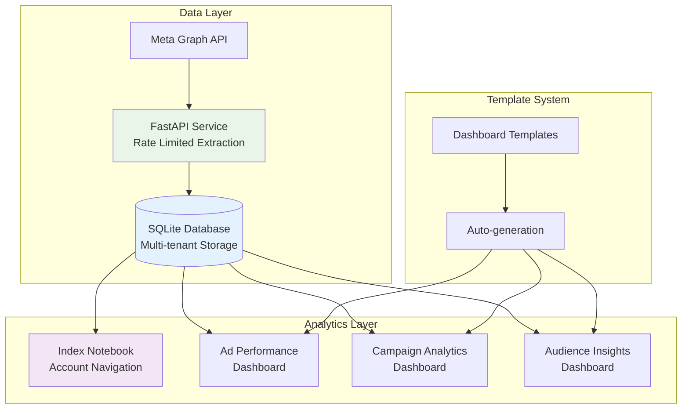

# 📊 Meta Ads Analytics Dashboard

Modern analytics platform combining **FastAPI** data extraction, **SQLite** storage, and **Marimo** interactive dashboards for Meta advertising insights.

## 🏗️ Architecture



## 🎯 Key Features

**📈 Interactive Dashboards**
- Real-time KPI visualization with Marimo notebooks
- Multi-account navigation and filtering
- Dynamic dashboard generation for new data types
- Responsive charts and data tables

**🔄 Automated Data Pipeline**
- Meta API extraction with intelligent rate limiting
- SQLite storage with multi-tenant architecture
- Automatic dashboard creation for new job types
- Error handling and data quality validation

**🛠️ Modular Architecture**
- Template-based dashboard generation
- Dynamic job type discovery
- Extensible for new data sources and visualizations

## 🎥 Demo

[](https://youtu.be/sK13eKQrKIY)

*Click the image above to watch a walkthrough of the current application state.*

## 🚀 Quick Start

### Prerequisites
- Python 3.13+
- UV package manager
- Meta Developer Account with access tokens

### 1. Setup Environment
```bash
# Clone and setup
git clone <repository>
cd meta-ads-analytics

# Install dependencies
uv sync

# Configure environment
cp .env.example .env
# Edit .env with your Meta access tokens
```

### 2. Initialize Database
```bash
# Setup SQLite database and schema
uv run python scripts/init_database.py

# Generate dashboard notebooks
uv run python scripts/generate_dashboards.py
```

### 3. Start the Analytics Platform
```bash
# Start FastAPI service (data extraction)
uv run uvicorn app.main:app --reload --port 8000

# Start Marimo dashboard (analytics interface)
uv run marimo run notebooks/index.py --port 2718

# Access dashboards
open http://localhost:2718
```

### 4. Extract and Analyze Data
```bash
# Extract data via API
curl -X POST http://localhost:8000/api/v1/extract \
  -H "Content-Type: application/json" \
  -d '{
    "account_ids": ["your_account_id"],
    "start_date": "2024-01-01",
    "end_date": "2024-01-31"
  }'

# Data is automatically stored in SQLite and available in dashboards
```

## 📊 Dashboard Features

### 🏠 Index Dashboard
- **Account Selection**: Multi-tenant account navigation
- **Dashboard Discovery**: Automatic detection of available analytics
- **System Status**: Database connectivity and data availability
- **Dynamic Navigation**: Links to specialized dashboards

### 📈 Analytics Dashboards
- **Ad Performance**: Campaign metrics, spend analysis, KPIs
- **Campaign Analytics**: Conversion tracking, ROAS analysis
- **Audience Insights**: Demographic and behavioral data
- **Custom Dashboards**: Auto-generated for new data types

### 🔧 API Endpoints

| Endpoint | Method | Description |
|----------|--------|-------------|
| `/api/v1/extract` | POST | Extract data to SQLite database |
| `/api/v1/accounts` | GET | List Meta ad accounts |
| `/api/v1/job-types` | GET | Available dashboard types |
| `/health` | GET | Health check |

## ⚙️ Configuration

### Environment Variables
```bash
# Meta API Configuration
META_ACCESS_TOKENS=token1,token2,token3,token4
META_API_VERSION=v23.0

# Database Configuration
SQLITE_DB_PATH=data/meta_ads.db

# Dashboard Configuration
MARIMO_PORT=2718
FASTAPI_PORT=8000

# Rate Limiting
MAX_CONCURRENT_REQUESTS=5
BASE_BACKOFF_SECONDS=2
```

## 🧪 Testing & Development

### Quick System Test
```bash
# Test data extraction and dashboard generation
uv run python run_test.py

# Verify database setup
sqlite3 data/meta_ads.db ".tables"

# Check dashboard generation
uv run python scripts/generate_dashboards.py

# Test dashboard functionality
uv run marimo run notebooks/index.py --headless
```

### Adding New Dashboard Types
```bash
# 1. Add job type to database
sqlite3 data/meta_ads.db "INSERT INTO data_job_types (job_type_id, job_name, description, table_name, is_active) VALUES ('new_type', 'New Analytics', 'Description', 'new_data_table', 1);"

# 2. Create corresponding table
sqlite3 data/meta_ads.db "CREATE TABLE new_data_table (id INTEGER PRIMARY KEY, account_id TEXT, ...);"

# 3. Auto-generate dashboard
uv run python scripts/generate_dashboards.py

# 4. Dashboard is automatically available in index
```

## 🔧 Project Structure

```
meta-ads-analytics/
├── app/                    # FastAPI service
│   ├── core/              # Configuration, database, rate limiting
│   ├── models/            # Pydantic models
│   ├── services/          # Meta API client, data extraction
│   └── main.py           # FastAPI application
├── notebooks/             # Marimo dashboards
│   ├── index.py          # Main navigation dashboard
│   ├── *_dashboard.py    # Auto-generated analytics dashboards
│   └── utils/            # Shared utilities and templates
├── scripts/               # Setup and maintenance scripts
│   ├── init_database.py  # Database initialization
│   └── generate_dashboards.py  # Dashboard generation
├── data/
│   └── meta_ads.db       # SQLite database
└── pyproject.toml        # Dependencies and configuration
```

### Key Technologies

- **FastAPI**: High-performance API for data extraction
- **SQLite**: Lightweight, serverless database for analytics data
- **Marimo**: Reactive notebooks for interactive dashboards
- **Plotly**: Interactive visualizations and charts
- **SQLAlchemy**: Database ORM and query management

## 📊 Data Architecture

### Multi-Tenant SQLite Database

**Database Schema:**
```sql
-- Account management
accounts (account_id, account_name, api_token_key, last_updated)

-- Job type registry
data_job_types (job_type_id, job_name, description, table_name, is_active)

-- Performance data tables
ad_performance_data (account_id, date_start, campaign_name, impressions, clicks, spend, ...)
campaign_analytics_data (account_id, date_start, campaign_name, conversions, roas, ...)
audience_insights_data (account_id, date_start, age_range, gender, location, ...)
```

**Data Flow:**
```
Meta API → FastAPI Service → SQLite Database → Marimo Dashboards
```

### Dashboard Generation System

**Template-Based Architecture:**
- Dynamic job type discovery from database
- Automatic dashboard notebook generation
- Schema-aware template adaptation
- Error handling and data validation

**Modular Design:**
- Each job type gets its own dashboard
- Shared utilities for common functionality
- Consistent UI patterns across dashboards
- Easy extensibility for new data types

## 🚀 Current Status

**✅ Implemented:**
- Meta API integration with intelligent rate limiting
- SQLite database with multi-tenant architecture
- Marimo interactive dashboard system
- Dynamic dashboard generation and discovery
- Template-based notebook creation
- Error handling and data validation
- Account navigation and filtering

**🔄 Available Extensions:**
- Additional Meta API endpoints (campaigns, adsets, ads)
- Custom dashboard templates
- Advanced visualizations and analytics
- Scheduled data extraction
- Export capabilities (CSV, Excel, PDF)

## 📚 Documentation

- **[🚀 Getting Started](GETTING_STARTED.md)**: Quick setup guide (start here!)
- **[🛠️ Development Guide](DEVELOPMENT.md)**: Adding dashboards and extending the system
- **[🏗️ Architecture](ARCHITECTURE.md)**: Technical architecture and design patterns
- **[🚀 Deployment](DEPLOYMENT.md)**: Production deployment and maintenance
- **[📊 Notebooks Guide](notebooks/README.md)**: Marimo dashboard development
- **[🔧 API Docs](http://localhost:8000/docs)**: Interactive API documentation (when running)

## 🤝 Contributing

1. Fork the repository
2. Create a feature branch
3. Add new job types or dashboard templates
4. Test with `uv run python scripts/generate_dashboards.py`
5. Submit a pull request

## 📄 License

This project is licensed under the MIT License.