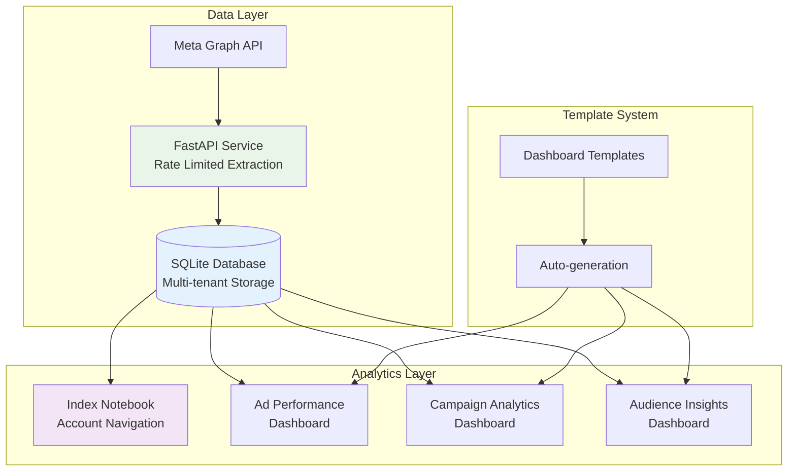

# 📊 Meta Ads Analytics Dashboard

Modern analytics platform combining **FastAPI** data extraction, **SQLite** storage, and **Marimo** interactive dashboards for Meta advertising insights.

> **Marketing Agency SaaS Tool** - Help agencies demonstrate ROI to clients from Meta (and future Google) ads. Currently in beta development for real-world validation with marketing agencies.

## 🏗️ Architecture



## 🎯 Beta v1.0.0 Roadmap Status

### Must Have Features
| Feature | Status | Notes |
|---------|--------|-------|
| Ad Performance Dashboard | ✅ Complete | Working with real data |
| Campaign Analytics Dashboard | ✅ Complete | Working with real data |
| **RNF Dashboard** | 🔧 Backend Ready | API extraction complete, dashboard pending |
| **Audience Analysis Dashboard** | 🔧 Backend Ready | API extraction complete, dashboard pending |
| Account Navigation | ✅ Complete | Multi-account switching working |
| Data Pull for Account | ✅ Complete | All 4 tokens validated, extraction tested |

### Good to Have
| Feature | Status | Notes |
|---------|--------|-------|
| Server Deployment Ready | 📝 Pending | Docker + deployment scripts needed |
| Local Runnable | ✅ Complete | UV-based setup works across systems |
| Docs & Context | ✅ Complete | Architecture, setup, and API docs ready |

### Delighters
| Feature | Status | Notes |
|---------|--------|-------|
| Onboarding Page | 📝 Pending | UI to add new accounts/tokens |
| Sub-domain Deployment | 📝 Pending | After deployment scripts |

### Latest Updates (Dec 2025)

**RNF (Reach & Frequency) Extraction - Backend Complete**
- Cumulative R&F extraction with daily/weekly/monthly breakdowns
- Audience overlap analysis (3-API-call pattern validated)
- Database schema: `rnf_cumulative_data`, `rnf_overlap_data` tables
- API endpoints: `/extract-rnf-cumulative`, `/extract-rnf-overlap`
- Tested with real Porter account: 3.5M reach, 1.67 frequency

**Audience Insights Extraction - Backend Complete**
- Demographic breakdowns: age, gender
- Geographic breakdowns: country, region
- Device/platform breakdowns
- Database schema: `audience_insights_data` table
- API endpoints: `/extract-audience`, `/audience/{account_id}`
- Tested with real data: 7 age segments, 5.2M peak reach (25-34)

**Token Management Validated**
- 4 tokens successfully rotating across API calls
- Rate limiting working as expected
- Access to 3 Porter accounts confirmed

**Next Immediate Steps:**
1. Build RNF Marimo dashboard (cumulative trends + overlap heatmap)
2. Build Audience Insights Marimo dashboard (demographic charts)
3. Test overlap computation with multiple campaigns
4. Create deployment scripts (Docker, server setup)

### 🧠 Key Learnings & Design Decisions

**Token Rotation Strategy**
- Insight: All 4 tokens are functionally identical (not for different purposes)
- Purpose: Round-robin rotation to avoid Meta API rate limits
- Implementation: Used across RNF overlap (3 calls per pair) and audience breakdowns
- Validated: Successfully tested with Porter account (3M+ reach data)

**RNF Overlap Computation**
- Pattern: 3 API calls per pair: `reach(A) + reach(B) - reach(A+B)`
- Challenge: 10 campaigns = 45 pairs = 135 API calls (expensive!)
- Solution: Store results in DB, allow on-demand refresh for recent data
- Real Result: Found 9% overlap between Mumbai and Bangalore campaigns

**Database Design**
- Multi-tenant from the start (account_id in all tables)
- Separate tables for cumulative vs overlap data (different query patterns)
- Breakdown storage: Single table with type + value columns (flexible)
- Indexes on account_id + date for dashboard performance

**API Design Philosophy**
- Test scripts first to understand Meta API responses
- Build services around validated patterns
- Pydantic validation for all endpoints
- Database operations through centralized manager

**Development Approach**
- Baby steps: Test → Schema → Service → API → Integration
- Real data validation at each step (Porter account: 3.5M reach, 5.8M impressions)
- No guesswork - verify API patterns before building services

## 🎯 Key Features

**📈 Interactive Dashboards**
- Real-time KPI visualization with Marimo notebooks
- Multi-account navigation and filtering
- Dynamic dashboard generation for new data types
- Responsive charts and data tables

**🔄 Automated Data Pipeline**
- Meta API extraction with intelligent rate limiting
- SQLite storage with multi-tenant architecture
- Automatic dashboard creation for new job types
- Error handling and data quality validation

**🛠️ Modular Architecture**
- Template-based dashboard generation
- Dynamic job type discovery
- Extensible for new data sources and visualizations

## 🎥 Demo

### 1st Iteration: 
[](https://youtu.be/sK13eKQrKIY)

### 2st Iteration: 
[](https://youtu.be/eNxnch44jfo)

*Click the image above to watch a walkthrough of the current application state.*

## 🚀 Quick Start

### Prerequisites
- Python 3.13+
- UV package manager
- Meta Developer Account with access tokens

### 1. Setup Environment
```bash
# Clone and setup
git clone <repository>
cd meta-ads-analytics

# Install dependencies
uv sync

# Configure environment
cp .env.example .env
# Edit .env with your Meta access tokens
```

### 2. Initialize Database
```bash
# Setup SQLite database and schema
uv run python scripts/init_database.py

# Generate dashboard notebooks
uv run python scripts/generate_dashboards.py
```

### 3. Start the Analytics Platform
```bash
# Start FastAPI service (data extraction)
uv run uvicorn app.main:app --reload --port 8000

# Start Marimo dashboard (analytics interface)
uv run marimo run notebooks/index.py --port 2718

# Access dashboards
open http://localhost:2718
```

### 4. Extract and Analyze Data
```bash
# Extract ad performance data
curl -X POST http://localhost:8000/api/v1/extract \
  -H "Content-Type: application/json" \
  -d '{
    "account_ids": ["your_account_id"],
    "start_date": "2024-01-01",
    "end_date": "2024-01-31"
  }'

# Extract RNF cumulative reach & frequency
curl -X POST http://localhost:8000/api/v1/extract-rnf-cumulative \
  -H "Content-Type: application/json" \
  -d '{
    "account_ids": ["your_account_id"],
    "start_date": "2024-01-01",
    "end_date": "2024-01-31",
    "level": "account",
    "time_increment": "1"
  }'

# Extract audience insights (demographics)
curl -X POST http://localhost:8000/api/v1/extract-audience \
  -H "Content-Type: application/json" \
  -d '{
    "account_ids": ["your_account_id"],
    "start_date": "2024-01-01",
    "end_date": "2024-01-31",
    "breakdown_types": ["age", "gender"]
  }'

# Data is automatically stored in SQLite and available in dashboards
```

## 📊 Dashboard Features

### 🏠 Index Dashboard
- **Account Selection**: Multi-tenant account navigation
- **Dashboard Discovery**: Automatic detection of available analytics
- **System Status**: Database connectivity and data availability
- **Dynamic Navigation**: Links to specialized dashboards

### 📈 Analytics Dashboards
- **Ad Performance**: Campaign metrics, spend analysis, KPIs
- **Campaign Analytics**: Conversion tracking, ROAS analysis
- **RNF Analysis** (New): Cumulative reach & frequency trends, audience overlap detection
- **Audience Insights** (New): Age, gender, geographic, and device breakdowns
- **Custom Dashboards**: Auto-generated for new data types

### 🔧 API Endpoints

**Core Data Extraction**
| Endpoint | Method | Description |
|----------|--------|-------------|
| `/api/v1/extract` | POST | Extract ad performance data |
| `/api/v1/extract-rnf-cumulative` | POST | Extract cumulative reach & frequency |
| `/api/v1/extract-rnf-overlap` | POST | Compute audience overlap (N² API calls) |
| `/api/v1/extract-audience` | POST | Extract audience insights with breakdowns |

**Data Retrieval**
| Endpoint | Method | Description |
|----------|--------|-------------|
| `/api/v1/accounts` | GET | List Meta ad accounts |
| `/api/v1/job-types` | GET | Available dashboard types |
| `/api/v1/data/{job_type}/{account_id}` | GET | Get stored data |
| `/api/v1/rnf-overlap/{account_id}` | GET | Get stored overlap results |
| `/api/v1/audience/{account_id}` | GET | Get stored audience insights |
| `/api/v1/audience/{account_id}/summary` | GET | Aggregated audience summary |

**System**
| Endpoint | Method | Description |
|----------|--------|-------------|
| `/health` | GET | Health check |
| `/api/v1/metrics` | GET | System metrics |
| `/docs` | GET | Interactive API documentation |

## ⚙️ Configuration

### Environment Variables
```bash
# Meta API Configuration
META_ACCESS_TOKENS=token1,token2,token3,token4
META_API_VERSION=v23.0

# Database Configuration
SQLITE_DB_PATH=data/meta_ads.db

# Dashboard Configuration
MARIMO_PORT=2718
FASTAPI_PORT=8000

# Rate Limiting
MAX_CONCURRENT_REQUESTS=5
BASE_BACKOFF_SECONDS=2
```

## 🧪 Testing & Development

### Quick System Test
```bash
# Test RNF extraction patterns
uv run python test_rnf_extraction.py

# Test audience insights extraction
uv run python test_audience_extraction.py

# Test end-to-end integration
uv run uvicorn app.main:app --port 8000 &
uv run python test_integration_rnf.py

# Verify database setup
sqlite3 data/meta_ads.db ".tables"

# Check dashboard generation
uv run python scripts/generate_dashboards.py

# Test dashboard functionality
uv run marimo run notebooks/index.py --headless
```

### Adding New Dashboard Types
```bash
# 1. Add job type to database
sqlite3 data/meta_ads.db "INSERT INTO data_job_types (job_type_id, job_name, description, table_name, is_active) VALUES ('new_type', 'New Analytics', 'Description', 'new_data_table', 1);"

# 2. Create corresponding table
sqlite3 data/meta_ads.db "CREATE TABLE new_data_table (id INTEGER PRIMARY KEY, account_id TEXT, ...);"

# 3. Auto-generate dashboard
uv run python scripts/generate_dashboards.py

# 4. Dashboard is automatically available in index
```

## 🔧 Project Structure

```
meta-ads-analytics/
├── app/                    # FastAPI service
│   ├── core/              # Configuration, database, rate limiting, logging, metrics
│   │   ├── database.py    # SQLite manager with RNF & audience tables
│   │   ├── token_manager.py  # Token rotation logic
│   │   └── rate_limiter.py   # Rate limit handling
│   ├── models/            # Pydantic models
│   │   ├── requests.py    # RNFCumulativeRequest, RNFOverlapRequest, AudienceRequest
│   │   └── responses.py   # API response models
│   ├── services/          # Meta API client, data extraction
│   │   ├── meta_client.py              # Meta Graph API client
│   │   ├── data_extraction_service.py  # Ad performance extraction
│   │   ├── rnf_extraction_service.py   # RNF extraction (NEW)
│   │   └── audience_extraction_service.py  # Audience extraction (NEW)
│   └── main.py           # FastAPI application with all endpoints
├── notebooks/             # Marimo dashboards
│   ├── index.py          # Main navigation dashboard
│   ├── ad_performance_dashboard.py      # Ad metrics dashboard
│   ├── campaign_analytics_dashboard.py  # Campaign analytics
│   ├── audience_insights_dashboard.py   # Audience demographics
│   └── utils/            # Shared utilities and templates
│       ├── dashboard_factory.py    # Dashboard discovery & creation
│       └── template_generator.py   # Template-based generation
├── scripts/               # Setup and maintenance scripts
│   ├── init_database.py        # Database initialization
│   └── generate_dashboards.py  # Dashboard generation
├── tests/                 # Test scripts
│   ├── test_rnf_extraction.py     # RNF pattern validation
│   ├── test_audience_extraction.py # Audience pattern validation
│   └── test_integration_rnf.py     # End-to-end integration test
├── data/
│   └── meta_ads.db       # SQLite database (auto-created)
└── pyproject.toml        # Dependencies and configuration
```

### Key Technologies

- **FastAPI**: High-performance API for data extraction
- **SQLite**: Lightweight, serverless database for analytics data
- **Marimo**: Reactive notebooks for interactive dashboards
- **Plotly**: Interactive visualizations and charts
- **SQLAlchemy**: Database ORM and query management

## 📊 Data Architecture

### Multi-Tenant SQLite Database

**Database Schema:**
```sql
-- Account management
accounts (account_id, account_name, api_token_key, last_updated)

-- Job type registry
data_job_types (job_type_id, job_name, description, table_name, is_active)

-- Performance data tables
ad_performance_data (account_id, date_start, campaign_name, impressions, clicks, spend, ...)

-- RNF (Reach & Frequency) tables
rnf_cumulative_data (account_id, date_start, analysis_level, entity_id, reach, frequency, cpp, ...)
rnf_overlap_data (account_id, date_start, analysis_level, entity1_id, entity2_id, overlap_count, ...)

-- Audience insights table
audience_insights_data (account_id, date_start, breakdown_type, breakdown_value, reach, impressions, ...)
```

**Data Flow:**
```
Meta API → FastAPI Service → SQLite Database → Marimo Dashboards
```

### Dashboard Generation System

**Template-Based Architecture:**
- Dynamic job type discovery from database
- Automatic dashboard notebook generation
- Schema-aware template adaptation
- Error handling and data validation

**Modular Design:**
- Each job type gets its own dashboard
- Shared utilities for common functionality
- Consistent UI patterns across dashboards
- Easy extensibility for new data types

## 🚀 Current Status

**✅ Implemented & Tested:**
- Meta API integration with intelligent rate limiting (4 tokens validated)
- SQLite database with multi-tenant architecture
- Marimo interactive dashboard system
- Dynamic dashboard generation and discovery
- Template-based notebook creation
- Error handling and data validation
- Account navigation and filtering
- **RNF (Reach & Frequency) Backend**: Cumulative extraction + overlap analysis
- **Audience Insights Backend**: Demographic and geographic breakdowns
- Token rotation across multiple API calls
- End-to-end extraction tested with real Porter account data

**🔧 In Development:**
- RNF Marimo dashboard (backend ready, UI pending)
- Audience Insights Marimo dashboard (backend ready, UI pending)
- Deployment scripts and Docker configuration

**📝 Planned:**
- Scheduled/cron-like data extraction jobs
- Account onboarding UI
- Export capabilities (CSV, Excel, PDF)
- Google Ads integration (future)

## 📚 Documentation

- **[🚀 Getting Started](GETTING_STARTED.md)**: Quick setup guide (start here!)
- **[🛠️ Development Guide](DEVELOPMENT.md)**: Adding dashboards and extending the system
- **[🏗️ Architecture](ARCHITECTURE.md)**: Technical architecture and design patterns
- **[🚀 Deployment](DEPLOYMENT.md)**: Production deployment and maintenance
- **[📊 Notebooks Guide](notebooks/README.md)**: Marimo dashboard development
- **[🔧 API Docs](http://localhost:8000/docs)**: Interactive API documentation (when running)

## 🤝 Contributing

1. Fork the repository
2. Create a feature branch
3. Add new job types or dashboard templates
4. Test with `uv run python scripts/generate_dashboards.py`
5. Submit a pull request

## 📄 License

This project is licensed under the MIT License.